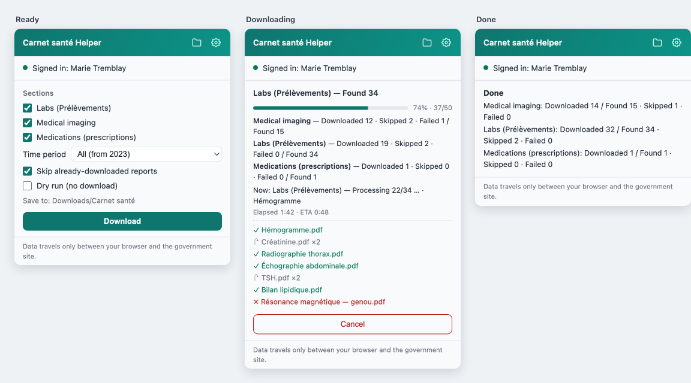
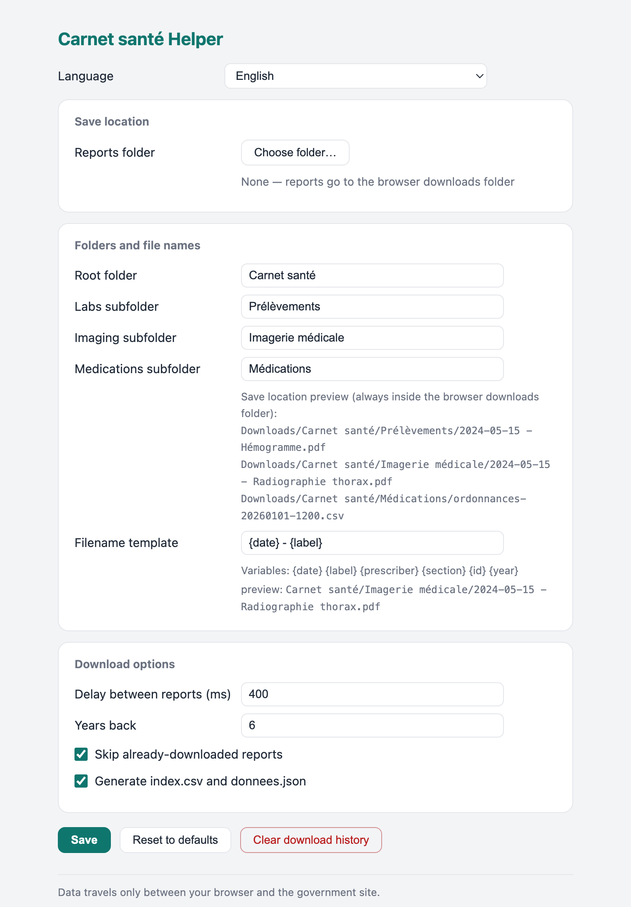

# مساعد Carnet santé (إضافة Chrome / Edge)

[English](README.md) · [Français](README.fr.md) · [中文](README.zh.md) · **العربية** · [Español](README.es.md) · [Kreyòl ayisyen](README.ht.md)

   

نزِّل دفعة واحدة ونظِّم تلقائيًا تقاريرك من [Carnet santé Québec](https://carnetsante.gouv.qc.ca) — بوابة السجلات الصحية في كيبك:

- **Prélèvements** (نتائج المختبر)
- **Imagerie médicale** (التصوير الطبي)
- **Médications** (الوصفات الطبية) — تُصدَّر كلقطة CSV/JSON مرتبة زمنيًا (الدواء، رقم DIN، الفئة، الطبيب الواصف، الصيدلية، التجديدات المتبقية…) لرؤية صورة أدويتك فترةً بفترة

لا توفر البوابة أي ميزة تصدير جماعي؛ هذه الإضافة تقوم بذلك نيابةً عنك، داخل جلسة تسجيل الدخول الخاصة بك. الواجهة تتحدث 13 لغة وتتبع الوضع الفاتح/الداكن لنظامك.

## الميزات

- **تنزيل جماعي بنقرة واحدة** — التحاليل والتصوير والوصفات، محصورة بالفترات التي تحتوي فعلًا على بيانات (تُكتشف تلقائيًا).
- **أرشفة تلقائية** — ملف PDF مؤرّخ لكل تقرير داخل مجلدات الأقسام، مع `index.csv` ملخّص (و`donnees.json`).
- **مجلدك، قواعدك** — احفظ في أي مكان على القرص أو في التنزيلات؛ أعد تسمية المجلدات؛ صمّم قالب اسم الملف.
- **تزايدي** — تُتخطى التقارير المنزَّلة سابقًا، فتجلب عمليات التشغيل الدورية الجديد فقط.
- **تاريخ الوصفات كبيانات** — لقطة CSV/JSON زمنية للأدوية (الدواء، DIN، الفئة، الطبيب، الصيدلية، التجديدات المتبقية).
- **تقدم واضح** — شريط تقدم، عدادات لكل قسم، الملف الحالي، المدة/المتبقي وسجل ملوّن.
- **خصوصية بالتصميم** — يعمل محليًا داخل جلستك المسجّلة؛ لا خدمة خارجية، ولا جمع أو إرسال.
- **مقروء في كل مكان** — 13 لغة للواجهة، والوضع الفاتح/الداكن.

## لقطات الشاشة



الإعدادات — مكان الحفظ، بنية المجلدات، قالب الاسم، والفاصل بين الطلبات:



## ما الذي تحصل عليه

كل ملف PDF مصنّف حسب التاريخ والاسم، مع فهرس ملخّص — في مجلد تنزيلات المتصفح (افتراضيًا) أو في أي مجلد تختاره:

```
Downloads/
└── Carnet santé/
    ├── Prélèvements/
    │   └── 2026-02-01 - Hémogramme.pdf
    ├── Imagerie médicale/
    │   └── 2026-05-15 - Radiographie thorax.pdf
    ├── Médications/
    │   ├── ordonnances-20261107-1530.csv    ← صف لكل وصفة، مرتب حسب التاريخ
    │   └── ordonnances-20261107-1530.json   ← البيانات نفسها + عدّادات سنوية
    ├── index-20261107-1530.csv      ← جدول ملخّص لجميع التقارير
    └── donnees-20261107-1530.json   ← البيانات نفسها بصيغة آلية
```

التقارير التي نُزِّلت سابقًا **تُتخطى تلقائيًا**، فيمكنك إعادة التشغيل دوريًا ولن تُجلب سوى التقارير الجديدة. لقطة الوصفات تُعاد توليدها في كل تشغيل (بضعة طلبات فقط؛ التجديدات المتبقية تتغير مع الوقت).

## التثبيت — مرة واحدة لكل حاسوب

**الخيار أ · عبر سكربت التثبيت (أسهل للتحديثات)**

على جهاز جديد (يلزم Git؛ المستودع عام، فلا حاجة إلى حساب GitHub):

macOS / Linux — الطرفية:
```sh
git clone https://github.com/bellchu/CarnetSanteHelper.git ~/Code/CarnetSanteHelper
bash ~/Code/CarnetSanteHelper/tools/install.sh
```

Windows — PowerShell:
```powershell
git clone https://github.com/bellchu/CarnetSanteHelper.git $HOME\Code\CarnetSanteHelper
cd $HOME\Code\CarnetSanteHelper
powershell -ExecutionPolicy Bypass -File tools\install.ps1
```

سبق أن استنسخته؟ من داخل المستودع شغّل `bash tools/install.sh` (macOS/Linux) أو `powershell -ExecutionPolicy Bypass -File tools\install.ps1` (Windows). يقوم السكربت بتحديث الشيفرة ونسخ مسار الإضافة إلى الحافظة وفتح صفحة إضافات المتصفح.

**الخيار ب · بدون Git — نزّل ملف ZIP**

1. نزّل ملف ZIP: [CarnetSanteHelper-main.zip](https://github.com/bellchu/CarnetSanteHelper/archive/refs/heads/main.zip) ← فكّ الضغط (مثل `CarnetSanteHelper-main`). في GitHub يمكنك أيضًا استخدام الزر الأخضر **Code** ← **Download ZIP**.
2. انسخ المسار الكامل **للمجلد المفكوك** (وليس ملف ZIP نفسه). في Windows: Shift + زر أيمن على المجلد ← **نسخ كمسار**.

**بعد ذلك، في Chrome أو Edge (الخطوة اليدوية الوحيدة — قاعدة أمنية في المتصفح للإضافات غير المنشورة):**

1. افتح `chrome://extensions` (في Edge: `edge://extensions`).
2. فعّل **وضع المطوّر** (أعلى اليمين).
3. اضغط **تحميل إضافة غير مفكوكة** ← الصق المسار (⌘⇧V / Ctrl+Shift+V) ← Enter.

✅ **تنجح عندما:** تظهر بطاقة "Carnet santé Helper" في الصفحة. نصيحة: ثبّتها — أيقونة قطعة الأحجية في شريط الأدوات ← تثبيت — لتكون دائمًا على بُعد نقرة واحدة.

**التحديث لاحقًا:** أعد تشغيل السكربت (أو أعد تنزيل ZIP)، ثم اضغط **إعادة تحميل ↻** على بطاقة الإضافة. هذه النقرة الأخيرة لا يمكن أتمتتها — إنها قاعدة المتصفح وليست خللًا.

## أول استخدام — 4 خطوات

1. **سجّل الدخول** إلى [carnetsante.gouv.qc.ca](https://carnetsante.gouv.qc.ca) وابقَ في أي صفحة من البوابة.
2. **اضغط أيقونة الإضافة.** خلال ثانية أو ثنتين يجب أن تعرض النافذة *تم تسجيل الدخول: اسمك*. إذا أفادت بعدم وجود جلسة: حدّث تبويب البوابة ثم أعد فتح النافذة.
3. **أول مرة؟ فعّل «مسح فقط»** واضغط *مسح* — يَعُدّ التقارير التي كان سيُنزّلها دون تنزيل شيء. أعجبتك الأرقام؟ ألغِ التحديد واضغط *تنزيل*.
4. **راقب التقدم** في النافذة (شريط تقدم، عدّادات لكل قسم، سجل مباشر). عند الانتهاء افتح ملفاتك بزر 📁 في أعلى النافذة. **لا تغلق تبويب البوابة أثناء التشغيل.**

## الإعدادات (⚙)

| الإعداد | وظيفته |
|---|---|
| مجلد التقارير | **اختر أي مجلد على قرصك** (Chrome/Edge لسطح المكتب): تُكتب التقارير مباشرة فيه مع المجلدات الفرعية. اختر «السماح في كل زيارة» عند منح الإذن لتجنب إعادة التفويض. يعود إلى مجلد التنزيلات إن لم يكن متاحًا |
| المجلد الجذر / المجلدات الفرعية | بنية الأرشيف، افتراضيًا `Carnet santé/Prélèvements` و`Imagerie médicale` و`Médications` (معاينة مباشرة؛ تُحوَّل المسارات المطلقة إلى نسبية — المتصفح يمنع الكتابة خارج مجلد التنزيلات) |
| قالب اسم الملف | متغيرات `{date} {label} {prescriber} {section} {id} {year}`، افتراضيًا `{date} - {label}` |
| الفاصل بين التقارير | 400ms افتراضيًا — أبقِه أعلى من 0، احترامًا للموقع |
| الفترة الزمنية | تُكتشف تلقائيًا: عند الفتح تستكشف الإضافة أقدم بياناتك وتعرض فقط الفترات الموجودة فعلًا (تجنّبًا لأخطاء النطاقات الفارغة)؛ فترات ثابتة إذا فشل الاستكشاف |
| تخطي المنزَّل | مفتاح منع التكرار؛ *مسح سجل التنزيلات* يفرض تنزيلًا كاملًا |

## كيف يعمل والخصوصية

البوابة تطبيق Angular دون واجهة برمجية عامة. تعيد الإضافة استخدام جلستك: تقرأ رمز OIDC الخاص بالبوابة من الصفحة، وتستدعي نقاط `/api/1` الخاصة نفسها التي يستخدمها الموقع (التصوير: قائمة ← بيانات ← PDF؛ المختبر: قوائم سنوية ← PDF بصيغة base64 داخل JSON؛ الأدوية: قائمة بشرائح ≤2 سنة، دون PDF — تُكتب كلقطة CSV/JSON)، وتحفظ عبر `chrome.downloads` أو واجهة File System Access.

كل شيء يجري محليًا في متصفحك. **الإضافة لا تتصل بأي خدمة خارجية ولا تجمع أي بيانات ولا ترسلها**؛ يُستخدم الرمز حصريًا لجلب سجلاتك أنت.

## حل المشكلات

| العَرَض | الحل |
|---|---|
| «لم يتم اكتشاف جلسة تسجيل دخول» | سجّل الدخول إلى البوابة وابقَ في صفحتها، حدّثها مرة، ثم أعد فتح النافذة |
| "Failed to fetch" | حجب شبكة/CORS: حدّث تبويب البوابة المتصل ثم أعد المحاولة |
| نافذة حفظ تظهر لكل ملف | إعداد «السؤال عن مكان حفظ كل ملف» مفعّل — عطّله من `chrome://settings/downloads` ثم أعد التشغيل |
| ⚠ على المجلد / الهدف يحمل ⚠ | انتهى التفويض (قد يحدث بعد إعادة تشغيل المتصفح): أعد اختيار المجلد في ⚙ الإعدادات |
| الملفات ليست في المجلد المختار | المجلد مُنقل/غير متصل ← عودة تلقائية إلى مجلد التنزيلات — انظر الأخطاء/السجل في النافذة |
| إخفاقات كثيرة / 401 أثناء التشغيل | انتهت صلاحية الرمز غالبًا — تجدده الإضافة تلقائيًا مرة واحدة؛ إن استمر، حدّث صفحة البوابة وأعد التشغيل (المنزَّل سابقًا يُتخطى) |
| «التحاليل غير متاحة» | الميزة غير مفعّلة لحسابك — تتخطى الإضافة هذا القسم وتكمل مع التصوير |
| سنوات معينة ترجع HTTP 500 | الخادم حساس لنطاقات التواريخ — تعيد الإضافة المحاولة تلقائيًا (تغيير الصيغة ← سنة بسنة)؛ ما يتبقى يُسجَّل كخطأ ويُتخطى، وغالبًا لتجاوزه مدة الاحتفاظ (~3 سنوات) |
| أجد الملفات أين؟ | زر 📁 أعلى النافذة؛ أو سجل تنزيلات المتصفح (تحت `Carnet santé/`) |

## القيود والتطوير

- يعتمد على نقاط `/api/1` الخاصة بالبوابة؛ إعادة تصميم حكومية قد تستلزم تحديثًا (النقاط مجمّعة أعلى `lib/pipeline.js`).
- التطعيمات في بوابة أخرى؛ قيم المختبر السنوية (`ResultatsAnalyse`) غير مشمولة.
- لتنظيم **سجلاتك الصحية الخاصة** — استخدمه بمسؤولية (الفاصل الافتراضي موجود لسبب).

للمطوّرين: `npm test` — 47 اختبار وحدة + تكامل يحاكي كامل المسار أمام `/api/1` زائفة. البنية: `lib/` (منطق وتنسيق)، `content/` (الرمز واستدعاءات الواجهة)، `background/` (التنزيلات والحالة)، `popup/`، `options/`، `folder/`.
