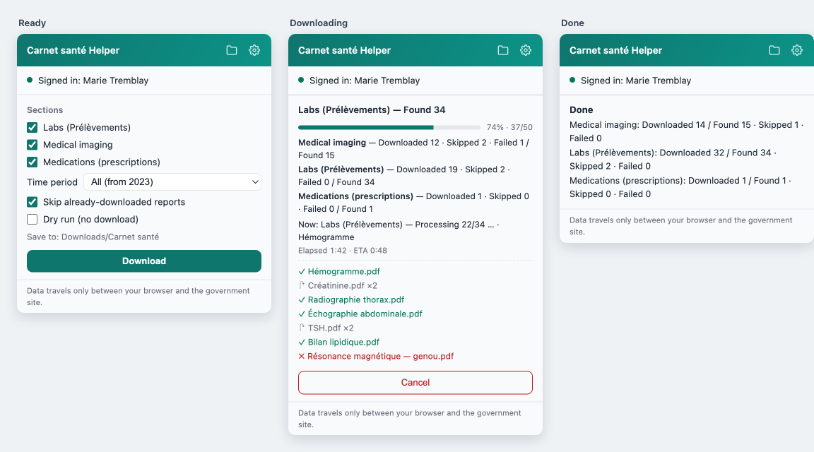
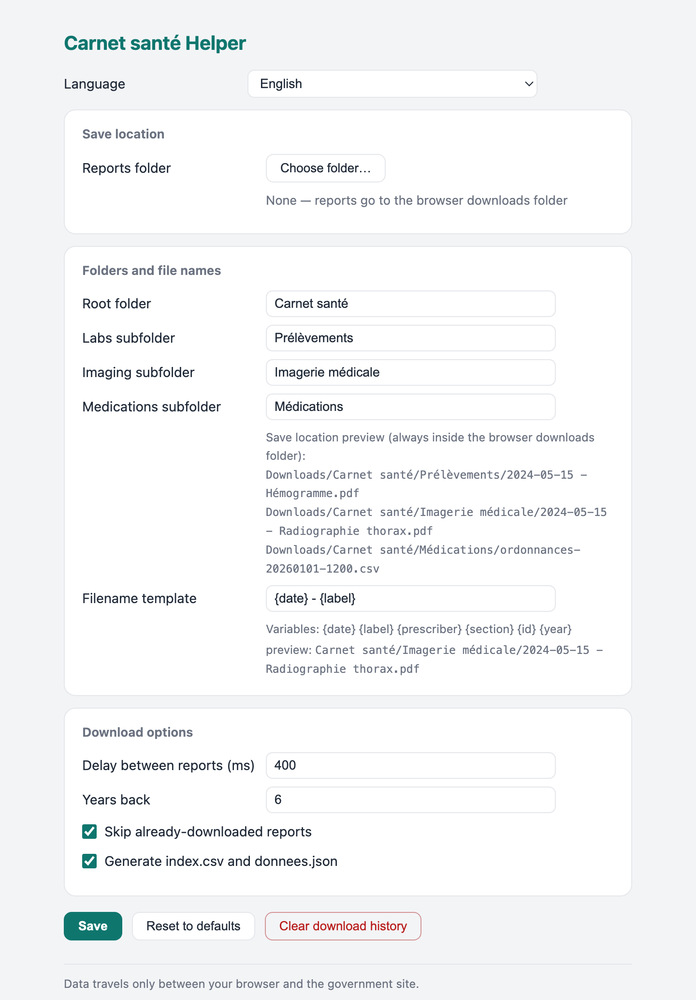

# Carnet santé Helper (Chrome / Edge extension)

**English** · [Français](README.fr.md) · [中文](README.zh.md) · [العربية](README.ar.md) · [Español](README.es.md) · [Kreyòl ayisyen](README.ht.md)

   

Bulk-download and auto-organize your reports from [Carnet santé Québec](https://carnetsante.gouv.qc.ca) — the Quebec health-record portal:

- **Prélèvements** (lab results)
- **Imagerie médicale** (medical imaging)
- **Médications** (doctor prescriptions) — exported as a chronological CSV/JSON snapshot (drug, DIN, class, prescriber, pharmacy, refills remaining…), so you can see your medication picture period by period

The portal has no bulk-export feature; this extension does it for you, inside your own signed-in session. The UI speaks 13 languages and follows your system's light/dark mode.

## Features

- **One-click bulk download** — labs, imaging and prescriptions, limited to periods that really contain data (detected automatically).
- **Archives itself** — one dated PDF per report in section folders, plus a summary `index.csv` (and `donnees.json`).
- **Your folder, your rules** — save anywhere on disk or in Downloads; rename the root/section folders; design your own filename template.
- **Incremental** — already-downloaded reports are skipped, so periodic re-runs fetch only what is new.
- **Prescription history as data** — a chronological CSV/JSON snapshot of medications (drug, DIN, class, prescriber, pharmacy, refills remaining).
- **Clear progress** — progress bar, per-section counters, current file, elapsed/ETA and a colour-coded log.
- **Private by design** — runs locally inside your own signed-in session; no third-party service, nothing collected or uploaded.
- **Readable everywhere** — 13 interface languages, light/dark mode.

## Screenshots



Settings — save location, folder layout, filename template and pacing:



## What you get

Every PDF filed by date and name, plus a summary index — in your browser's Downloads folder (default) or any folder you pick:

```
Downloads/
└── Carnet santé/
    ├── Prélèvements/
    │   └── 2026-02-01 - Hémogramme.pdf
    ├── Imagerie médicale/
    │   └── 2026-05-15 - Radiographie thorax.pdf
    ├── Médications/
    │   ├── ordonnances-20261107-1530.csv    ← prescriptions, one row each, sorted by date
    │   └── ordonnances-20261107-1530.json   ← same + per-year counts (medication overview)
    ├── index-20261107-1530.csv      ← summary table of all reports
    └── donnees-20261107-1530.json   ← same data, machine-readable
```

Already-downloaded reports are **skipped automatically**, so you can re-run periodically and only new reports are fetched. The prescriptions snapshot is regenerated on each run (a handful of requests; refills change over time).

## Install — once per computer

**Option A · with the install script (easiest updates)**

On a new machine (this repo is private — Git + your GitHub login required):

macOS / Linux — Terminal:
```sh
gh repo clone bellchu/CarnetSanteHelper ~/Code/CarnetSanteHelper
bash ~/Code/CarnetSanteHelper/tools/install.sh
```

Windows — PowerShell:
```powershell
gh repo clone bellchu/CarnetSanteHelper $HOME\Code\CarnetSanteHelper
cd $HOME\Code\CarnetSanteHelper
powershell -ExecutionPolicy Bypass -File tools\install.ps1
```

Already cloned? From the repo, run `bash tools/install.sh` (macOS/Linux) or `powershell -ExecutionPolicy Bypass -File tools\install.ps1` (Windows). The script updates the code, copies the extension path to your clipboard and opens the browser's extensions page.

**Option B · no Git — download a ZIP**

1. On GitHub: green **Code** button → **Download ZIP** → unzip it (e.g. `CarnetSanteHelper-main`).
2. Copy the full path of the **unzipped** folder (not the ZIP file). Windows tip: Shift+right-click the folder → **Copy as path**.

**Then, in Chrome or Edge (the one manual step — browser security requires it for unpublished extensions):**

1. Open `chrome://extensions` (Edge: `edge://extensions`).
2. Turn on **Developer mode** (top-right).
3. Click **Load unpacked** → paste the path (⌘⇧V / Ctrl+Shift+V) → Enter.

✅ **Done when:** a "Carnet santé Helper" card appears on that page. Tip: pin it — click the puzzle-piece icon in the toolbar and pin the extension, so it's always one click away.

**Updating later:** re-run the script (or re-download the ZIP), then click **Reload ↻** on the extension card. That last click can't be automated — it's a browser rule, not a bug.

## First use — 4 steps

1. **Sign in** at [carnetsante.gouv.qc.ca](https://carnetsante.gouv.qc.ca) and stay on any portal page.
2. **Click the extension icon.** Within a second or two the popup should show *Signed in: your name*. If it reports no session: refresh the portal tab, then reopen the popup.
3. **First time? Tick "Dry run"** and press *Scan only* — it counts the reports that would be downloaded, without downloading. Happy with the numbers? Untick, then press *Download*.
4. **Watch the progress** in the popup (progress bar, per-section counts, live file log). When it finishes, open your files with the 📁 button in the popup header. **Don't close the portal tab while it runs.**

## Settings (⚙)

| Setting | What it does |
|---|---|
| Reports folder | **Pick any folder on your disk** (Chrome/Edge desktop): reports are written directly into it, with subfolders. Choose "Allow on every visit" when granting access, to avoid re-authorizing. Falls back to Downloads if unavailable |
| Root / section subfolders | Archive layout, default `Carnet santé/Prélèvements` + `Imagerie médicale` + `Médications` (live preview in settings; absolute paths are converted to relative — the browser forbids writing outside Downloads) |
| Filename template | Variables `{date} {label} {prescriber} {section} {id} {year}`, default `{date} - {label}` |
| Delay between reports | Default 400 ms — please keep it above 0, it's polite to the site |
| Time period | Detected automatically: on open the extension probes your earliest available data and only offers periods that actually exist (avoids errors on empty ranges); fixed ranges if detection fails |
| Skip downloaded | Dedup switch; *Clear download history* forces a full re-download |

## How it works & privacy

The portal is an Angular app with a private API. The extension reuses your existing session: it reads the portal's own OIDC token from the page, calls the same `/api/1` endpoints the site itself uses (imaging: list → report metadata → PDF; labs: yearly lists → PDF embedded as base64 in JSON; medications: list queried in ≤2-year slices, no PDF — written out as a CSV/JSON snapshot), and saves via `chrome.downloads` or the File System Access API.

Everything runs locally in your browser. **The extension talks to no third-party service and collects/uploads nothing**; the token is only used to fetch your own records.

## Troubleshooting

| Symptom | Fix |
|---|---|
| Popup says no session | Sign in to the portal, stay on its page, refresh once, reopen the popup |
| "Failed to fetch" | Network/CORS block: refresh the signed-in portal tab, then retry |
| A save dialog pops up for every file | Browser setting "Ask where to save each file" is on — turn it off at `chrome://settings/downloads`, then re-run |
| Folder shows ⚠ / popup target has ⚠ | Folder authorization expired (can happen after a browser restart): re-pick it in ⚙ Settings |
| Files not in the chosen folder | If the folder was moved/unplugged, files fall back to Downloads — see the errors/log lines in the popup |
| Many failures / 401 mid-run | Token likely expired — the extension auto-refreshes once; if it persists, refresh the portal page and re-run (finished files are skipped) |
| "Labs not available" | The labs feature isn't enabled for your account — the extension skips labs and continues with imaging |
| Some years fail with HTTP 500 | Server is picky about date ranges; the extension retries automatically (format swap → year-by-year). Rare leftovers are recorded as errors and skipped — those years may exceed the online retention (~3 years) |
| Can't find the files | Popup header 📁 button; or check browser downloads (they're under `Carnet santé/` in Downloads) |

## Limits & development

- Depends on the portal's private `/api/1` endpoints; a government redesign may require an update (endpoints are grouped at the top of `lib/pipeline.js`).
- Vaccinations are on a different portal; per-year lab values (`ResultatsAnalyse`) are not included.
- For organizing **your own** health records — please use responsibly (the default delay is there for a reason).

Developers: `npm test` — 47 node:test unit + integration tests covering the full pipeline against a mock `/api/1`. Layout: `lib/` (logic + orchestration, dependency-injected), `content/` (token + API calls), `background/` (downloads & state), `popup/`, `options/`, `folder/`.
