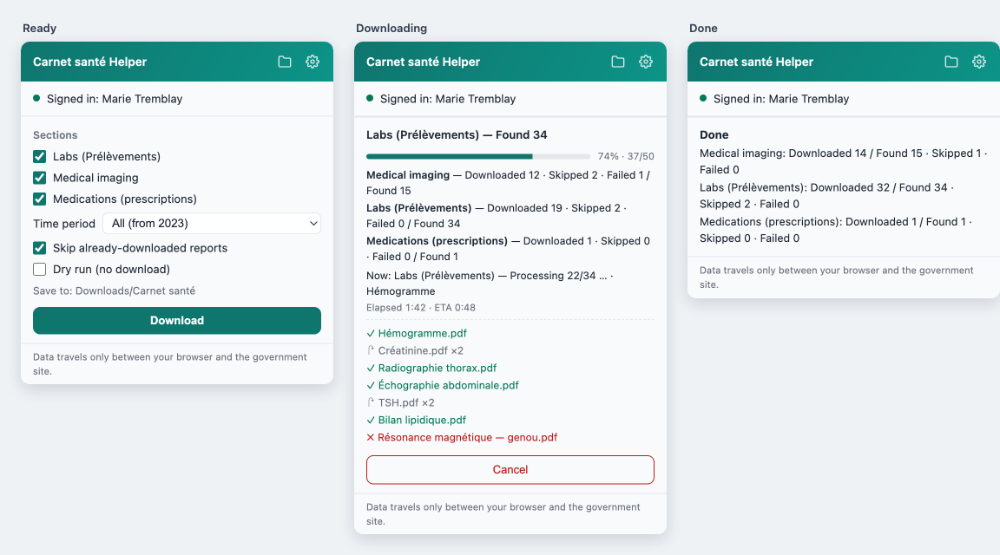
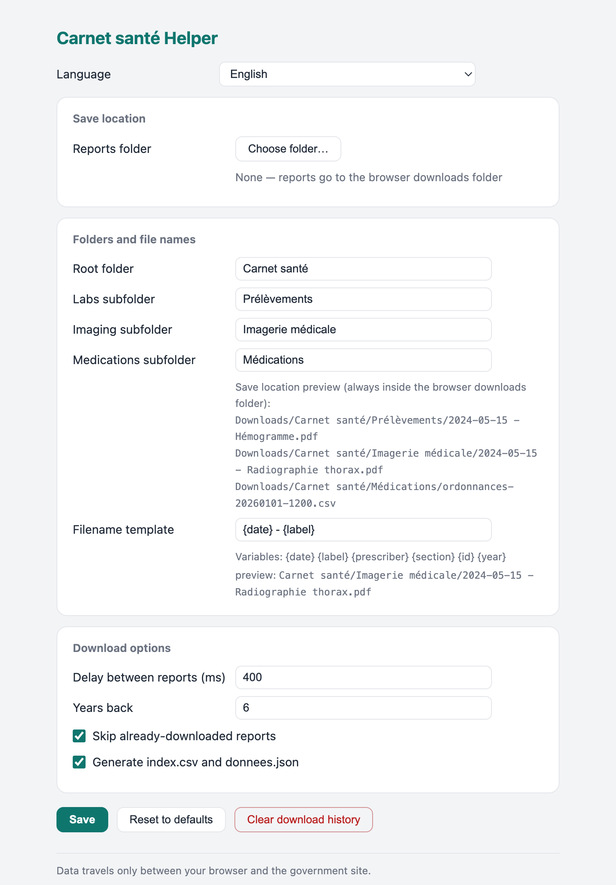

# Carnet santé Helper（Chrome / Edge 扩展）

[English](README.md) · [Français](README.fr.md) · **中文** · [العربية](README.ar.md) · [Español](README.es.md) · [Kreyòl ayisyen](README.ht.md)

   

一键**批量下载**并**自动整理**[Carnet santé Québec](https://carnetsante.gouv.qc.ca)（魁省健康记录门户）的三类报告——

- **Prélèvements**（化验 / 采样报告）
- **Imagerie médicale**（医学影像报告）
- **Médications**（医生处方药）——导出为按时间排序的 CSV/JSON 快照（药名、DIN、类别、处方医生、药房、剩余取药次数等），方便按时间段了解用药概况

门户本身没有批量导出功能；本扩展在你的登录会话内替你完成。界面支持 13 种语言，并自动跟随系统深 / 浅色模式。

## 功能一览

- **一键批量下载**——化验、影像与处方药，只选取确实有数据的时段（自动检测）。
- **自动归档**——每份报告一个带日期的 PDF，按板块分文件夹，并生成汇总 `index.csv`（及 `donnees.json`）。
- **文件夹随你定**——可保存到磁盘任意位置或下载目录；自定义根目录/子目录名与文件名模板。
- **增量下载**——已下载的报告自动跳过，定期重跑只获取新增内容。
- **处方史数据化**——按时间排序的用药 CSV/JSON 快照（药名、DIN、类别、处方医生、药房、剩余取药次数）。
- **进度清晰**——进度条、分板块计数、当前文件、用时/预计剩余与彩色日志。
- **本地隐私**——在你自己的登录会话内本地运行；不连第三方服务，不收集、不上传任何数据。
- **随处可读**——界面支持 13 种语言，跟随系统深/浅色模式。

## 截图



设置页——保存位置、目录结构、文件名模板与请求间隔：



## 你会得到什么

所有 PDF 按日期与名称归档，并生成汇总清单——默认在浏览器下载目录（也可自选任意文件夹）：

```
Downloads/
└── Carnet santé/
    ├── Prélèvements/
    │   └── 2026-02-01 - Hémogramme.pdf
    ├── Imagerie médicale/
    │   └── 2026-05-15 - Radiographie thorax.pdf
    ├── Médications/
    │   ├── ordonnances-20261107-1530.csv    ← 处方记录，每张一方，按日期排序
    │   └── ordonnances-20261107-1530.json   ← 同样数据 + 分年份计数（用药概况）
    ├── index-20261107-1530.csv      ← 全部报告的汇总表
    └── donnees-20261107-1530.json   ← 同样数据的机器可读版
```

已下载过的报告**自动跳过**，可以定期重跑，只增量获取新报告。处方药快照每次运行重新生成（仅数次请求；剩余取药次数会随时间变化）。

## 安装——每台电脑一次

**方式 A · 用安装脚本（更新最省事）**

新机器上（本仓库为私有，需要 Git 与你的 GitHub 登录）：

macOS / Linux——终端：
```sh
gh repo clone bellchu/CarnetSanteHelper ~/Code/CarnetSanteHelper
bash ~/Code/CarnetSanteHelper/tools/install.sh
```

Windows——PowerShell：
```powershell
gh repo clone bellchu/CarnetSanteHelper $HOME\Code\CarnetSanteHelper
cd $HOME\Code\CarnetSanteHelper
powershell -ExecutionPolicy Bypass -File tools\install.ps1
```

已克隆过？在仓库目录里直接 `bash tools/install.sh`（macOS/Linux）或 `powershell -ExecutionPolicy Bypass -File tools\install.ps1`（Windows）。脚本会更新代码、把扩展路径复制到剪贴板、并打开浏览器的扩展管理页。

**方式 B · 不用 Git——下载 ZIP**

1. 在 GitHub 上点绿色 **Code** → **Download ZIP** → 解压（如 `CarnetSanteHelper-main`）。
2. 复制**解压后文件夹**的完整路径（不是 ZIP 文件本身）。Windows 小技巧：按住 Shift 右键文件夹 → **复制文件地址**。

**接着在 Chrome 或 Edge 里（唯一的人工一步——未上架扩展必须如此，是浏览器安全规则）：**

1. 打开 `chrome://extensions`（Edge 为 `edge://extensions`）。
2. 打开右上角**开发者模式**。
3. 点**加载已解压的扩展程序** → 粘贴路径（⌘⇧V / Ctrl+Shift+V）→ 回车。

✅ **看到什么算成功：** 页面上出现 "Carnet santé Helper" 卡片。小技巧：点工具栏拼图图标把它**固定**到工具栏，以后一键即达。

**日后更新：** 重跑脚本（或重新下载 ZIP），然后在扩展卡片上点**重新加载 ↻**。最后这一下无法全自动——浏览器规则所限，不是 bug。

## 首次使用——4 步

1. 登录 [carnetsante.gouv.qc.ca](https://carnetsante.gouv.qc.ca)，停留在门户任意页面。
2. **点扩展图标**：一两秒内弹窗应显示 *已登录：你的姓名*。若提示未检测到会话：刷新门户标签页，再重开弹窗。
3. **第一次用？先勾「仅扫描」**点「开始扫描」——只统计会发现多少报告、不实际下载。数字满意后取消勾选，点「开始下载」。
4. 在弹窗里**看进度**（进度条、分板块计数、逐条彩色日志）。结束后用弹窗顶部的 📁 按钮打开文件。**下载过程中不要关闭门户标签页。**

## 设置（⚙）

| 设置 | 说明 |
|---|---|
| 报告保存文件夹 | **自选任意磁盘文件夹**（Chrome/Edge 桌面版）：报告连同子目录直接写入该文件夹。授权时选「允许每次访问」可免重复授权；不可用时回退下载目录 |
| 根文件夹 / 各板块子文件夹名 | 归档结构，默认 `Carnet santé/Prélèvements`、`Imagerie médicale`、`Médications`（设置页有实时预览；填绝对路径会自动转为相对路径——浏览器禁止写到下载目录以外） |
| 文件名模板 | 可用变量 `{date} {label} {prescriber} {section} {id} {year}`，默认 `{date} - {label}` |
| 每份报告间隔 | 默认 400ms——请保持大于 0，对站点友好 |
| 时间段 | 自动检测：打开弹窗时先探测最早可用数据，只列出真实存在数据的时间段（避免查询无数据区间报错）；检测失败则回退固定档位 |
| 跳过已下载 | 去重开关；「清除已下载记录」可强制全量重下 |

## 工作原理与隐私

门户是无公开 API 的 Angular 应用。扩展复用你已有的登录会话：读取门户自身的 OIDC 令牌、以与网站前端相同的方式调用其私有 `/api/1` 接口（影像：列表 → 元数据 → PDF；化验：按年列表 → JSON 内嵌 base64 PDF；处方药：按 ≤2 年分段列表，无 PDF，写出 CSV/JSON 快照），经 `chrome.downloads` 或 File System Access 保存。

全部处理都在本机浏览器完成。**扩展不连接任何第三方服务，不收集、不上传任何数据**；令牌仅用于以你的身份获取你自己的记录。

## 故障排查

| 症状 | 处理 |
|---|---|
| 弹窗提示未检测到登录会话 | 登录门户并停留在其页面，刷新一次后重开弹窗 |
| 报 "Failed to fetch" | 网络跨域拦截：刷新已登录的门户标签页后重试 |
| 每份文件都弹出「保存位置」对话框 | 浏览器开了「下载前询问每个文件的保存位置」；到 `chrome://settings/downloads` 关闭后重跑 |
| 设置页文件夹 ⚠ / 弹窗目标带 ⚠ | 授权过期（浏览器重启后可能发生）：到 ⚙ 设置里重选一次该文件夹 |
| 文件没进所选文件夹 | 文件夹被移动 / 拔盘时会自动改存下载目录——见弹窗里的错误与日志行 |
| 下载中途大量失败 / 401 | 令牌可能过期——扩展会自动取新令牌重试一次；仍失败就刷新门户页重跑（已下载的自动跳过） |
| 提示化验板块"未开放" | 该功能未对你开启——扩展会跳过化验、继续处理影像 |
| 个别年份 HTTP 500 | 服务端对日期跨度/格式敏感——扩展自动重试（换格式 → 按年二分）；个别遗留记入错误并跳过，多为超出在线保留期（约 3 年） |
| 找不到下载的文件 | 弹窗顶部 📁 按钮；或查浏览器下载记录（在下载目录的 `Carnet santé/` 子文件夹里） |

## 限制与开发

- 依赖门户私有 `/api/1` 端点；政府改版可能需要跟进更新（端点集中在 `lib/pipeline.js` 顶部）。
- 不含疫苗接种（另一门户）；不含逐年化验数值明细（`ResultatsAnalyse`）。
- 仅供整理**本人**健康记录——请合理使用（默认请求间隔即是为此）。

开发者：`npm test` —— 47 个 node:test 单元 + 集成测试（针对模拟 `/api/1` 的完整流水线）。目录：`lib/`（纯逻辑与编排）、`content/`（读令牌、调接口）、`background/`（下载与状态）、`popup/`、`options/`、`folder/`。
